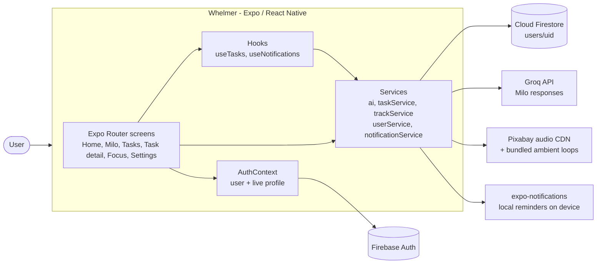
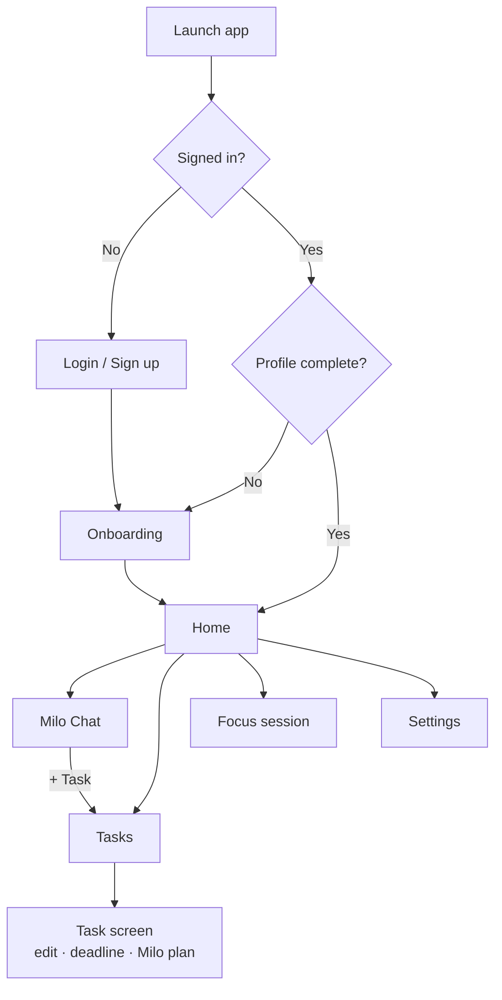

# Whelmer

**A gentle AI focus & task companion for ADHD and executive dysfunction**

>**Whelmer** is a calm, low-pressure productivity app for people navigating ADHD, burnout and executive dysfunction. Instead of long to-do lists and anxious countdowns, it pairs **AI micro-task breakdown** with an **ambient focus player** and a supportive AI companion named **Milo**.


**▶️ [Watch the demo video](https://youtube.com/shorts/dbEnwsnVFe0?si=_d1JmCQhX2yzX-G4)**

---

---

## 📱 Mockups

### Meet Milo — AI companion


### From Chat to Checklist — micro-step tasks


### Focus Zone — ambient focus sessions


### Made for You — secure, personalised setup


---

## ✨ Features

- 💬 **Milo, your AI companion** — an empathetic, non-judgemental "body double" powered by the **Groq API** (`groq-sdk`, automatically selects an available text model). Replies render as clean Markdown (headings, lists, bold), with no stray `**` or `###`.
- 🧠 **Personalised Milo** — the user's name, main goal (*Task Breakdown*, *Deep Focus* or *Habit Routines*), focus length and peak focus time shape every reply. At their peak time Milo suggests the hardest step first; outside it, lighter steps.
- 📋 **Micro-step tasks, synced** — save Milo's breakdown in one tap. The task heading comes from what the user asked ("I need to build a rocket" → **Build a Rocket**), and Milo's sub-points nest inside each step as smaller tickable steps, so a 5-step plan stays 5 steps. Everything persists in Firestore across devices.
- 🗂️ **A screen for every task** — rename the task and any step, add or remove steps and smaller steps, tick things off, and set an **optional deadline** with calm quick choices (Today, Tomorrow, In 3 days, Next week · Morning, Afternoon, Evening, Night).
- 🗓️ **Milo's gentle time plan** — with a deadline set, Milo suggests when to do each remaining step, using the user's peak focus time, with buffers and breaks and no late nights.
- 🌱 **Encouraging progress** — a banner celebrates tasks finished and every step ticked off ("2 of 5 tasks finished. Well done! 🌿"), because even small progress deserves recognition.
- 🎧 **Focus sessions & soundscapes** — a vinyl-style player whose timer starts at the user's chosen focus length. "Start Quick Session" on Home starts it straight away. Two streamed lo-fi tracks plus eight bundled ambient loops that play offline.
- 🔔 **Gentle reminders (local notifications)** — "Focus session complete", a nudge at the user's peak focus time naming the task due soonest, and soft deadline reminders the day before and a few hours before. Each has action buttons ("Yes, let's go" / "Not now"), quiet hours 21:30–08:00 and a 45-minute minimum gap so they never pile up. No server push, by design.
- 📳 **Haptic feedback** — a happy double buzz when a task or focus session is finished, controlled by the Settings switch.
- 🔒 **Account controls** — real profile on Settings, editable focus profile, working log out, **change password** and **delete account** (both re-check the password), plus JSON data export.

---

## 🧩 Diagrams

### System architecture



### User flow



### Design system

A light-only, neurodivergent-friendly palette chosen to reduce sensory load while keeping text contrast accessible.

| Token | Hex | Use |
| :--- | :--- | :--- |
| Cream | `#F3F5E9` | Background |
| Teal | `#7EC2C6` | Headers, buttons, active tab |
| Teal Ink | `#1B3C3E` | Text on teal, timer |
| Sage | `#D6E2A3` | Milo & secondary actions |
| Ink | `#2C3E35` | Primary text |
| Amber | `#E6A15C` | Progress |

**Accessibility:** touch targets of at least 48 × 48 dp, large type, generous spacing, and no flashing or red urgency cues.

---

## 🛠️ Tech Stack

| Layer | Technology |
| :--- | :--- |
| Framework | React Native 0.86 · Expo SDK 57 · React 19 |
| Language | TypeScript |
| Navigation | Expo Router (file-based, stack + bottom tabs) |
| UI | React Native `StyleSheet`, React Native Paper, `@expo/vector-icons` |
| Backend & database | Firebase Authentication · Cloud Firestore |
| AI service | Groq API (`groq-sdk`) |
| Audio | `expo-audio` |
| Notifications & haptics | `expo-notifications` (local only) · React Native `Vibration` |
| Build & deploy | EAS Build (`preview` profile → installable Android APK) |
| Other | `react-native-gesture-handler`, `react-native-reanimated` |

### Project structure

```
Whelmer/
├── README.md
├── LICENSE
├── docs/mockups/               # README mockups
└── whelmer/                    # Expo app
    ├── app/                    # Expo Router routes
    │   ├── _layout.tsx         # Root stack + auth guard
    │   ├── login.tsx           # Sign in / sign up
    │   ├── onboarding.tsx      # Preference setup
    │   ├── settings.tsx        # Account, focus profile, reminders, password, delete
    │   ├── task/[id].tsx       # One task: edit, deadline, Milo's time plan
    │   ├── (auth)/             # Auth group
    │   └── (tabs)/
    │       ├── _layout.tsx     # Bottom tab bar
    │       ├── index.tsx       # Home dashboard
    │       ├── milo.tsx        # Milo AI chat
    │       ├── tasks.tsx       # Task groups & micro-steps
    │       └── focus.tsx       # Vinyl player & focus timer
    ├── src/
    │   ├── context/AuthContext.tsx   # Signed-in user + live Firestore profile
    │   ├── hooks/              # useTasks (live tasks + actions), useNotifications
    │   ├── services/           # firebase, ai (Groq), taskService, trackService,
    │   │                       # userService, notificationService
    │   ├── components/MiloMarkdown.tsx
    │   ├── utils/              # dates, encouragement, haptics
    │   ├── constants/Colors.ts
    │   └── types/user.ts
    ├── assets/                 # App icon, splash, Milo avatars, audio loops
    ├── firestore.rules         # Security rules (paste into the Firebase console)
    ├── eas.json                # EAS Build profiles (preview = APK)
    ├── app.json
    └── package.json
```

---

## 🚀 Installation & Setup

Whelmer is a mobile frontend (Expo) backed by Firebase (auth + database) and the Groq API (AI). There is no separate server to run.

### Prerequisites

- [Node.js](https://nodejs.org/) 20.19+, 22.13+ or 24.3+
- [Expo Go](https://expo.dev/go) on your phone, or an Android emulator / iOS simulator
- A [Firebase project](https://console.firebase.google.com/)
- A [Groq API key](https://console.groq.com/keys)

### 1. Frontend

```bash
git clone https://github.com/GabyNor05/Whelmer.git
cd Whelmer/whelmer
npm install
```

### 2. Backend & database (Firebase)

1. In the [Firebase console](https://console.firebase.google.com/), create a project and add a **Web app** to get your config values.
2. **Authentication → Sign-in method:** enable **Email/Password**.
3. **Firestore Database:** create a database, then copy the contents of [`whelmer/firestore.rules`](whelmer/firestore.rules) into **Rules** and publish. The rules only let a signed-in user read or write their own `users/{uid}` branch, and they check the shape of every task document (title length, step count, deadline and Milo plan types).

### 3. AI service (Groq)

Create a free API key at the [Groq console](https://console.groq.com/keys).

### 4. Environment variables

Create `whelmer/.env`:

```bash
EXPO_PUBLIC_FIREBASE_API_KEY=your_firebase_api_key
EXPO_PUBLIC_FIREBASE_AUTH_DOMAIN=your_project.firebaseapp.com
EXPO_PUBLIC_FIREBASE_PROJECT_ID=your_project_id
EXPO_PUBLIC_FIREBASE_STORAGE_BUCKET=your_project.appspot.com
EXPO_PUBLIC_FIREBASE_MESSAGING_SENDER_ID=your_sender_id
EXPO_PUBLIC_FIREBASE_APP_ID=your_app_id
EXPO_PUBLIC_GROQ_API_KEY=your_groq_api_key
```

> `.env` is git-ignored — never commit your keys.

### 5. Run the app

```bash
npx expo start
```

Scan the QR code with Expo Go, or press `a` for Android / `i` for iOS.

---

## 🧑‍💻 Usage Guide

The app has four bottom tabs — **Home, Milo Chat, Tasks, Focus** — plus Settings.

1. **Create an account.** Sign up with an email and password on the Login screen.
2. **Complete onboarding.** Choose a nickname, peak focus time, default focus length and main goal, then toggle notifications, autoplay and haptics.
3. **Home.** See Milo's check-in, your current tasks and a shortcut into a focus session.
4. **Milo Chat.** Tap a prompt chip such as *"Break down my task"*, or type a goal (e.g. *"I need to clean my room"*). Milo replies with small steps — tap **+ Task** under the reply to save them as a task group.
5. **Tasks.** The banner at the top celebrates your progress. Tap a task to open its own screen: tick steps and smaller steps, rename or remove anything, add new steps, and set an optional deadline. With a deadline, tap **Suggest times for my steps** for Milo's gentle plan. Swipe left on a task in the list to delete it.
6. **Focus.** Pick a soundscape and press play; the timer starts at your default focus length. The vinyl spins while the session runs, and you get a gentle buzz and notification when it ends.
7. **Settings.** Tap the settings icon on Home. Change your name or password, adjust your focus profile (focus length, peak time, main goal), switch Gentle Reminders and haptics on or off, export your data, log out, or permanently delete your account.

> **Quick test path:** Sign up → Onboarding → Milo: *"I need to build a rocket"* → tap **+ Task** → Tasks: open **Build a Rocket**, tick a smaller step, add a deadline, tap **Suggest times for my steps** → Focus: start a session.

### Notifications in Expo Go vs the APK

Since Expo SDK 53, Expo Go can't load `expo-notifications` without errors, so Whelmer switches all notification code off when it detects Expo Go. Everything else works in Expo Go. Reminders work in the installed APK: open **Settings → Gentle Reminders**, switch it on and allow notifications.

---

## 🔒 Security & Privacy

- Each user's profile and tasks live under `users/{uid}` in Firestore, protected by rules tied to `request.auth.uid`; task writes are also validated by the rules.
- Changing the password or deleting the account re-checks the current password (`reauthenticateWithCredential`). Deleting removes every task, the profile and the login.
- API keys are loaded from environment variables, not hard-coded, and `.env` is kept out of Git.
- **Known limit:** `EXPO_PUBLIC_` keys are bundled into the app, so the Groq key could be extracted from the APK. The production fix is to move AI calls behind a Firebase Cloud Function.
- Milo's system prompt keeps responses focused on supportive productivity coaching.

---

## 📦 Android APK (EAS Build)

Whelmer builds as a standalone Android app with [EAS Build](https://docs.expo.dev/build/setup/), so it runs without Expo Go and supports local notifications.

```bash
npm install -g eas-cli
eas login
cd whelmer
eas build -p android --profile preview
```

- **`eas.json`** defines a `preview` profile that outputs an installable `.apk` (internal distribution).
- **`.easignore`** (repo root) replaces `.gitignore` for EAS uploads, so `.env` is included in the build while `node_modules` and generated native folders are not.
- When the build finishes, open the link or QR code on an Android phone, download the APK and allow installing from that source.

**Problems fixed on the way to a working build:**

| Problem | Fix |
| :--- | :--- |
| `expo-doctor`: invalid `scheme` | Changed `"Whelmer"` to lowercase `"whelmer"` |
| Missing `expo-font` peer dependency | `npx expo install expo-font` (icons can crash outside Expo Go without it) |
| Top-level `splash` removed in SDK 57 | Moved the splash settings into the `expo-splash-screen` plugin |
| `npm ci`: *Missing react-native-worklets@0.10.4 from lock file* | npm had pulled in a newer Reanimated (4.7.1) than SDK 57 supports; pinned `react-native-reanimated` 4.5.1 and `react-native-worklets` 0.10.1 with `npx expo install` |
| Unused `expo-av` | Removed, as it is no longer supported on SDK 57 |
| APK built and installed, but showed a **blank screen** after the splash | `app/index.tsx` (the start route) rendered nothing. Expo Go always had a logged-in user, so it skipped straight past it; a fresh install did not. The start route now redirects to login or Home, and the root layout sends logged-out users there too |

---

## 🧭 Roadmap

- [x] Persist tasks and micro-steps to Firestore (`users/{uid}/tasks`)
- [x] Task screen with editing, optional deadlines and Milo's time plan
- [x] Local reminders with action buttons, and haptic feedback
- [x] Standalone Android APK via EAS Build
- [ ] Move Groq calls behind a Firebase Cloud Function so the key never ships in the app
- [ ] Optional server push, off by default
- [ ] Studio-recorded soundscapes to replace the generated ambient loops
- [ ] A one-colour notification icon
- [ ] Save Milo chat history to Firestore
- [ ] Automated tests for step parsing, reminder planning and CRUD
- [ ] Shared theme tokens file for all colours
- [ ] Notebook / daily journal (backlog)

---

## 👥 Contributions

| Contributor | Role | Contribution |
| :--- | :--- | :--- |
| **Gabrielle Norris** | Developer & designer | Research, UX/UI design, front-end development, Firebase and AI integration, testing |
| **Tsungai Katsuro** | Lecturer, repository collaborator | Project supervision, guidance and feedback |
| **Caylin Oosterhuizen** | Illustrator | Whelmer logo and all Milo character variations |

### AI tools used

AI tools supported development but are credited as tools, not as contributors:

- **Claude (Anthropic)** — generated and debugged code for features including Firestore task sync, Milo's Markdown rendering, the task screen with deadlines and time plans, local reminders, haptics and the Settings account controls; diagnosed and fixed the EAS build issues; drafted documentation
- **Google Gemini** — development assistance during early prototyping

---

## 📚 References & Acknowledgements

- **Expo & Expo Router documentation** — [docs.expo.dev](https://docs.expo.dev/)
- **React Native documentation** — [reactnative.dev](https://reactnative.dev/)
- **Firebase documentation** (Auth & Firestore) — [firebase.google.com/docs](https://firebase.google.com/docs)
- **Groq API & `groq-sdk`** — [console.groq.com/docs](https://console.groq.com/docs)
- **Ambient soundscapes** — two streamed royalty-free tracks from [Pixabay](https://pixabay.com/music/), used under the Pixabay Content License; eight ambient loops generated for the project and bundled in `assets/audio`
- **EAS Build** — [docs.expo.dev/build](https://docs.expo.dev/build/setup/)
- **Logo & Milo illustrations** — Kaylin Oosterhuizen
- **Icons** — [`@expo/vector-icons`](https://icons.expo.fyi/)
- **Libraries** — React Native Paper, react-native-markdown-display, react-native-gesture-handler
- Thanks to my lecturers at **Open Window Institute** for their guidance and feedback.

---

## 📄 License

Distributed under the MIT License. See [LICENSE](LICENSE) for details.

*Made with care by Gabrielle Norris · Open Window Institute · 2026*
