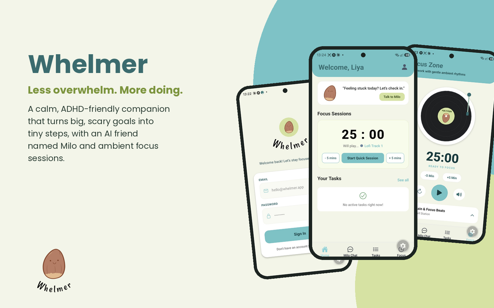
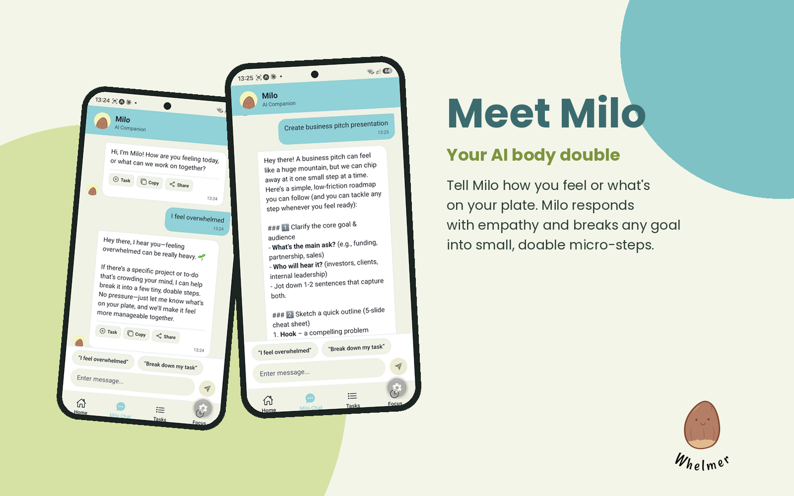
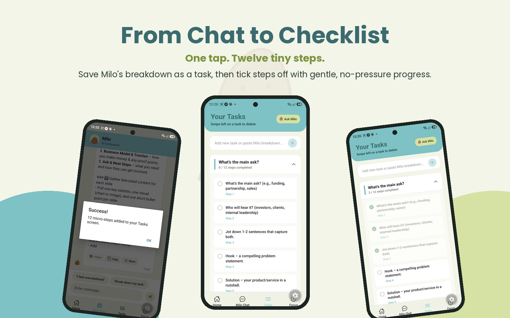
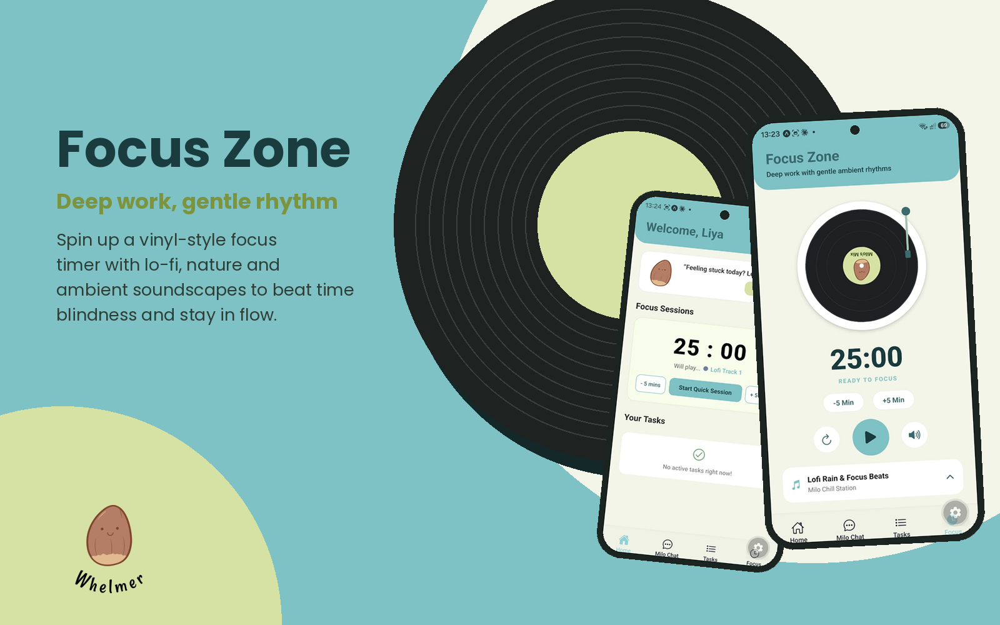
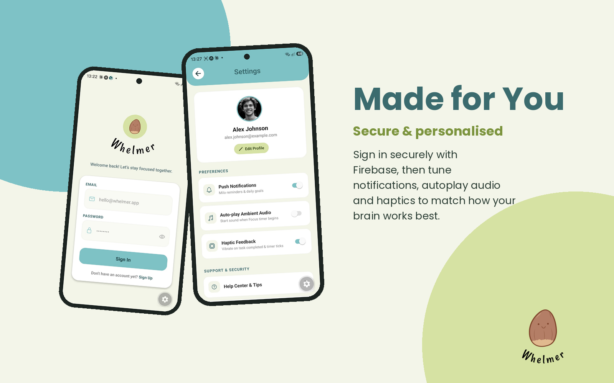
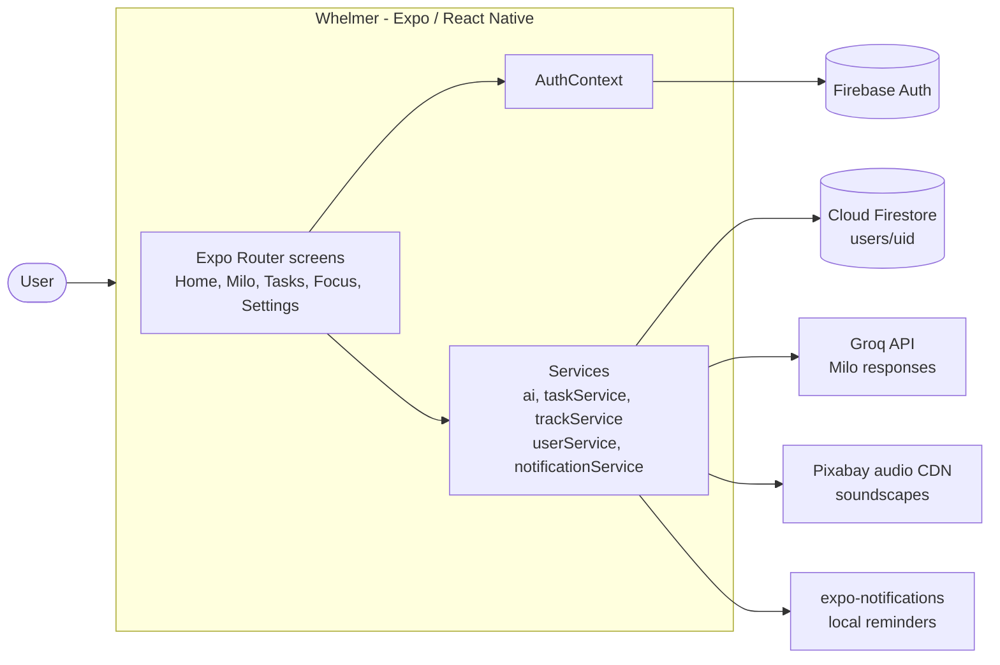
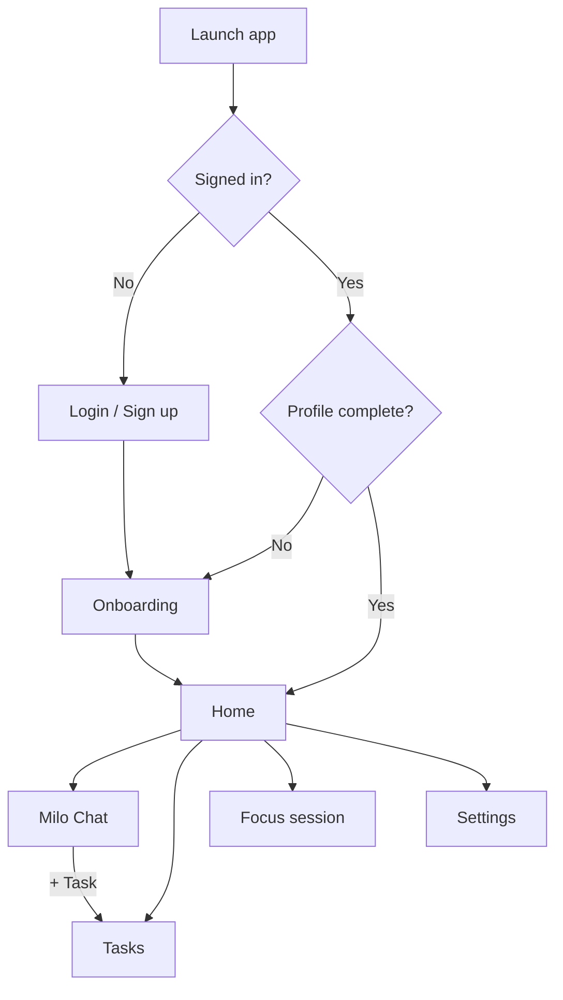

# Whelmer

**A gentle AI focus & task companion for ADHD and executive dysfunction**

[](https://expo.dev/)
[](https://reactnative.dev/)
[](https://www.typescriptlang.org/)
[](https://firebase.google.com/)
[](https://groq.com/)
[](LICENSE)



**▶️ [Watch the demo video](https://youtube.com/shorts/dbEnwsnVFe0?si=_d1JmCQhX2yzX-G4)**

---

## 📖 About

**Whelmer** is a calm, low-pressure productivity app for people navigating ADHD, burnout and executive dysfunction. Instead of long to-do lists and anxious countdowns, it pairs **AI micro-task breakdown** with an **ambient focus player** and a supportive AI companion named **Milo**.

| Friction point | How Whelmer helps |
| :--- | :--- |
| **Task paralysis** | Milo splits a big, vague goal into small, concrete micro-steps you can save as a task in one tap. |
| **Time blindness** | A visual focus timer with a spinning vinyl player makes time passing feel tangible. |
| **Sensory overload** | A soft cream-and-teal palette, no red badges, no aggressive alerts. |
| **Getting started** | Milo check-ins and prompt chips ("I feel overwhelmed", "Break down my task") remove the blank-page problem. |

> **Student:** Gabrielle Norris · Interactive Development & UX Design · Open Window Institute

---

## 🎬 Demo Video

▶️ **[Watch the Whelmer demo](ADD_DEMO_VIDEO_LINK_HERE)**

---

## 📱 Mockups

### Meet Milo — AI companion



### From Chat to Checklist — micro-step tasks



### Focus Zone — ambient focus sessions



### Made for You — secure, personalised setup



---

## ✨ Features

- 💬 **Milo, your AI companion** — an empathetic, non-judgemental "body double" powered by the **Groq API** (`groq-sdk`, automatically selects an available text model). Replies render as clean Markdown.
- 📋 **Micro-step task manager** — save Milo's breakdown as a task group, tick off sub-steps and watch progress fill without percentage pressure.
- 🎧 **Focus sessions & soundscapes** — a vinyl-style player with a configurable focus timer and streamed lo-fi, nature and ambient tracks via `expo-audio`.
- 🧭 **Personalised onboarding** — nickname, peak focus time, default focus length, main goal and preferences (notifications, autoplay, haptics), saved to Firestore.
- 🔒 **Secure accounts** — Firebase Authentication with persistent sessions (AsyncStorage) and per-user profile documents in Cloud Firestore.
- 🔔 **Gentle reminders** — optional local notifications through `expo-notifications`.

---

## 🧩 Diagrams

### System architecture



### User flow



### Design system

A light-only, neurodivergent-friendly palette chosen to reduce sensory load while keeping text contrast accessible.

| Token | Hex | Use |
| :--- | :--- | :--- |
| Cream | `#F3F5E9` | Background |
| Teal | `#7EC2C6` | Headers, buttons, active tab |
| Teal Ink | `#1B3C3E` | Text on teal, timer |
| Sage | `#D6E2A3` | Milo & secondary actions |
| Ink | `#2C3E35` | Primary text |
| Amber | `#E6A15C` | Progress |

**Accessibility:** touch targets of at least 48 × 48 dp, large type, generous spacing, and no flashing or red urgency cues.

---

## 🛠️ Tech Stack

| Layer | Technology |
| :--- | :--- |
| Framework | React Native 0.86 · Expo SDK 57 · React 19 |
| Language | TypeScript |
| Navigation | Expo Router (file-based, stack + bottom tabs) |
| UI | React Native `StyleSheet`, React Native Paper, `@expo/vector-icons` |
| Backend & database | Firebase Authentication · Cloud Firestore |
| AI service | Groq API (`groq-sdk`) |
| Audio | `expo-audio` |
| Other | `expo-notifications`, `react-native-gesture-handler`, `react-native-markdown-display` |

### Project structure

```
Whelmer/
├── README.md
├── LICENSE
├── docs/mockups/               # README mockups
└── whelmer/                    # Expo app
    ├── app/                    # Expo Router routes
    │   ├── _layout.tsx         # Root stack + auth guard
    │   ├── login.tsx           # Sign in / sign up
    │   ├── onboarding.tsx      # Preference setup
    │   ├── settings.tsx        # Account & app settings
    │   ├── (auth)/             # Auth group
    │   └── (tabs)/
    │       ├── _layout.tsx     # Bottom tab bar
    │       ├── index.tsx       # Home dashboard
    │       ├── milo.tsx        # Milo AI chat
    │       ├── tasks.tsx       # Task groups & micro-steps
    │       └── focus.tsx       # Vinyl player & focus timer
    ├── src/
    │   ├── context/AuthContext.tsx
    │   ├── services/           # firebase, ai (Groq), taskService, trackService,
    │   │                       # userService, notificationService
    │   ├── constants/Colors.ts
    │   └── types/user.ts
    ├── assets/                 # App icon, splash, Milo mood avatars
    ├── app.json
    └── package.json
```

---

## 🚀 Installation & Setup

Whelmer is a mobile frontend (Expo) backed by Firebase (auth + database) and the Groq API (AI). There is no separate server to run.

### Prerequisites

- [Node.js](https://nodejs.org/) 20 or later
- [Expo Go](https://expo.dev/go) on your phone, or an Android emulator / iOS simulator
- A [Firebase project](https://console.firebase.google.com/)
- A [Groq API key](https://console.groq.com/keys)

### 1. Frontend

```bash
git clone https://github.com/GabyNor05/Whelmer.git
cd Whelmer/whelmer
npm install
```

### 2. Backend & database (Firebase)

1. In the [Firebase console](https://console.firebase.google.com/), create a project and add a **Web app** to get your config values.
2. **Authentication → Sign-in method:** enable **Email/Password**.
3. **Firestore Database:** create a database, then paste these rules under **Rules** and publish:
   ```js
   rules_version = '2';
   service cloud.firestore {
     match /databases/{database}/documents {
       match /users/{uid} {
         allow read, write: if request.auth != null && request.auth.uid == uid;
       }
       match /users/{uid}/{document=**} {
         allow read, write: if request.auth != null && request.auth.uid == uid;
       }
     }
   }
   ```

### 3. AI service (Groq)

Create a free API key at the [Groq console](https://console.groq.com/keys).

### 4. Environment variables

Create `whelmer/.env`:

```bash
EXPO_PUBLIC_FIREBASE_API_KEY=your_firebase_api_key
EXPO_PUBLIC_FIREBASE_AUTH_DOMAIN=your_project.firebaseapp.com
EXPO_PUBLIC_FIREBASE_PROJECT_ID=your_project_id
EXPO_PUBLIC_FIREBASE_STORAGE_BUCKET=your_project.appspot.com
EXPO_PUBLIC_FIREBASE_MESSAGING_SENDER_ID=your_sender_id
EXPO_PUBLIC_FIREBASE_APP_ID=your_app_id
EXPO_PUBLIC_GROQ_API_KEY=your_groq_api_key
```

> `.env` is git-ignored — never commit your keys.

### 5. Run the app

```bash
npx expo start
```

Scan the QR code with Expo Go, or press `a` for Android / `i` for iOS.

---

## 🧑‍💻 Usage Guide

The app has four bottom tabs — **Home, Milo Chat, Tasks, Focus** — plus Settings.

1. **Create an account.** Sign up with an email and password on the Login screen.
2. **Complete onboarding.** Choose a nickname, peak focus time, default focus length and main goal, then toggle notifications, autoplay and haptics.
3. **Home.** See Milo's check-in, your current tasks and a shortcut into a focus session.
4. **Milo Chat.** Tap a prompt chip such as *"Break down my task"*, or type a goal (e.g. *"I need to clean my room"*). Milo replies with small steps — tap **+ Task** under the reply to save them as a task group.
5. **Tasks.** Expand a task to see its micro-steps and tick each one as you go; the progress bar fills as you move through them.
6. **Focus.** Pick a soundscape, set the timer and press play. The vinyl spins while the session runs.
7. **Settings.** Tap the profile icon on Home to edit your profile and preferences, or log out.

> **Quick test path:** Sign up → Onboarding → Milo: *"Break down: write my essay"* → tap **+ Task** → Tasks: tick a step → Focus: start a session.

---

## 🔒 Security & Privacy

- Each user's profile lives at `users/{uid}` in Firestore, protected by rules tied to `request.auth.uid`.
- API keys are loaded from environment variables, not hard-coded.
- Milo's system prompt keeps responses focused on supportive productivity coaching.

---

## 🧭 Roadmap

- [ ] Persist tasks and micro-steps to Firestore (`users/{uid}/tasks`) — currently held in memory per session
- [ ] Standalone Android APK via EAS Build
- [ ] Shared theme tokens file for all colours
- [ ] Notebook / daily journal (backlog)

---

## 👥 Contributions

| Contributor | Role | Contribution |
| :--- | :--- | :--- |
| **Gabrielle Norris** | Developer & designer | Research, UX/UI design, front-end development, Firebase and AI integration, testing |
| **Tsungai Katsuro** | Lecturer, repository collaborator | Project supervision, guidance and feedback |
| **Caylin Oosterhuizen** | Illustrator | Whelmer logo and all Milo character variations |

### AI tools used

AI tools supported development but are credited as tools, not as contributors:

- **Claude (Anthropic)** — code review, debugging support and documentation drafting
- **Google Gemini** — development assistance during early prototyping

---

## 📚 References & Acknowledgements

- **Expo & Expo Router documentation** — [docs.expo.dev](https://docs.expo.dev/)
- **React Native documentation** — [reactnative.dev](https://reactnative.dev/)
- **Firebase documentation** (Auth & Firestore) — [firebase.google.com/docs](https://firebase.google.com/docs)
- **Groq API & `groq-sdk`** — [console.groq.com/docs](https://console.groq.com/docs)
- **Ambient soundscapes** — royalty-free tracks from [Pixabay](https://pixabay.com/music/), used under the Pixabay Content License
- **Logo & Milo illustrations** — Kaylin Oosterhuizen
- **Icons** — [`@expo/vector-icons`](https://icons.expo.fyi/)
- **Libraries** — React Native Paper, react-native-markdown-display, react-native-gesture-handler
- Thanks to my lecturers at **Open Window Institute** for their guidance and feedback.

---

## 📄 License

Distributed under the MIT License. See [LICENSE](LICENSE) for details.

*Made with care by Gabrielle Norris · Open Window Institute · 2026*
